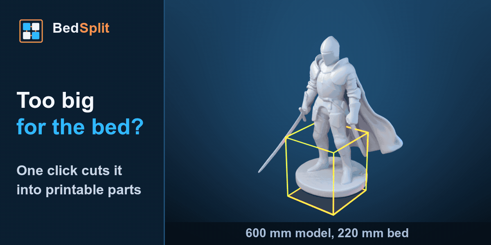
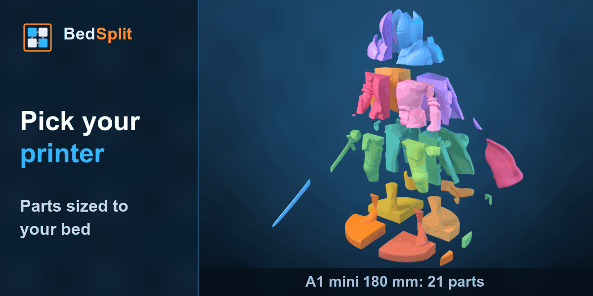
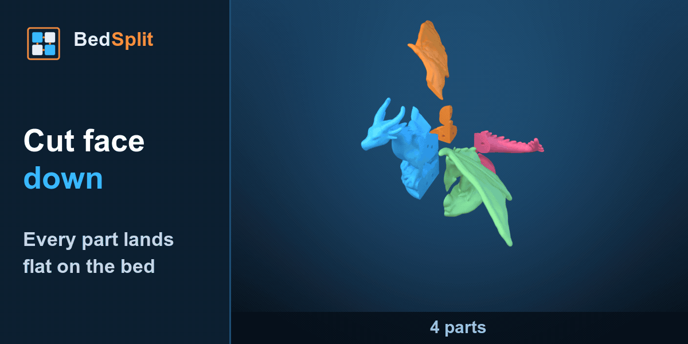
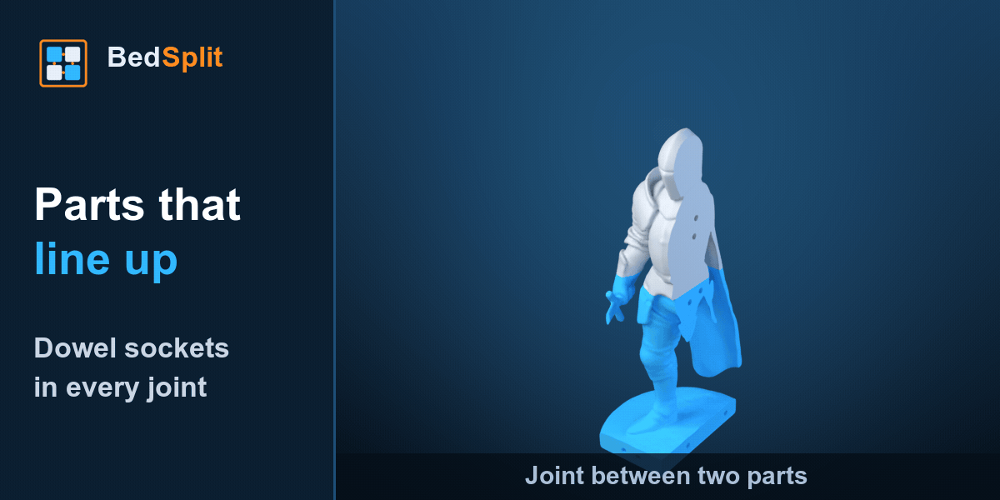
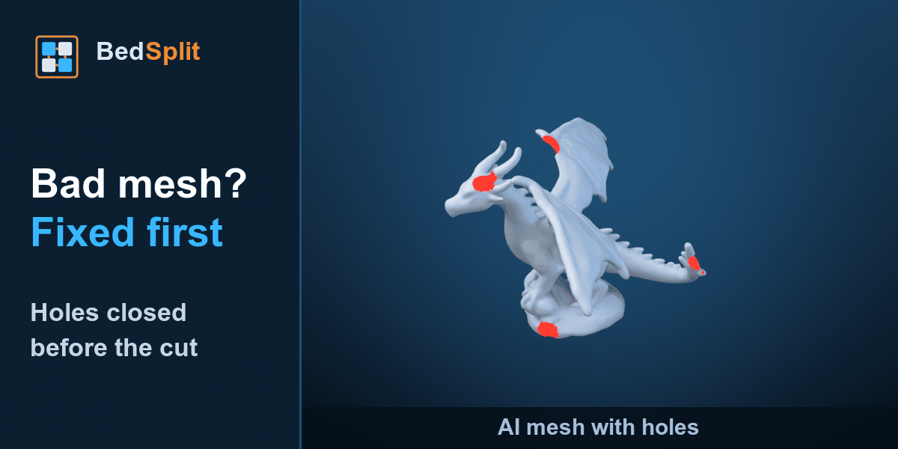
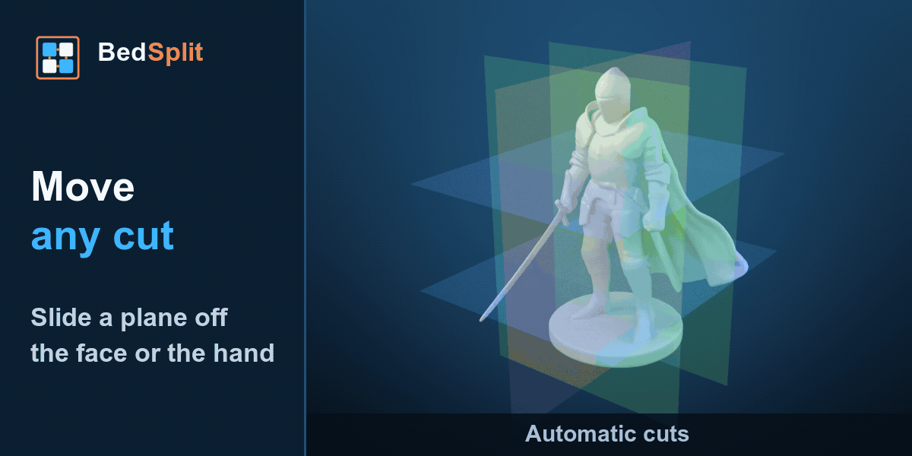

# BedSplit Lite — free Blender add-on to split a model for 3D printing and fit the printer bed

**Full version with dowels and sockets, mesh repair and movable cuts → [Gumroad](https://quadfix.gumroad.com/l/bedsplit) | [Superhive](https://superhivemarket.com/products/bedsplit)**

BedSplit Lite is a free, open-source Blender add-on that splits a model for 3D printing so that every part fits your printer bed. Pick your printer (Bambu Lab, Prusa, Creality, Anycubic, Elegoo, Sovol, Voron) or type a bed size, press **Split to Bed**, get flat-cut, closed parts laid out next to the model, and export one STL per part. For Blender 4.2 LTS, 4.5 LTS and 5.x.

[Download the latest release](https://github.com/quadfix-tools/bedsplit-lite/releases/latest) · [Trailer of the full version on YouTube](https://youtu.be/-EbloCRxfUs)

*One click: the model is cut into parts that fit the bed. (This clip is from the full version, which also adds dowel sockets at the joints. Lite makes the same cuts without sockets.)*

## What Lite does

| Step | What it does |
|---|---|
| **Printer presets** | 18 presets: Bambu Lab A1 mini, A1 / P1 / X1, H2D; Prusa MINI+, MK4 / MK3, XL, CORE One; Creality Ender 3 / V3 SE, K1, K1 Max, Ender 5 Plus; Anycubic Kobra 2 and 3; Elegoo Neptune 4 and 4 Max; Sovol SV06; Voron 2.4 and 0.2. Or type your own width, depth and height. |
| **Resize for print** | Type the real size of the longest side in millimetres (for example 600 mm for a statue). No unit setup, no scale maths. |
| **Split to Bed** | Finds the cut positions by itself. Flat cuts along X, Y and Z, every cut face is capped, so each part is a closed solid. Parts that fit the bed are not cut again. |
| **Parts laid out flat** | Every part is turned so that its cut face lies on the ground and placed beside the model, each in its own colour. Your original is not changed. Undo (`Cmd/Ctrl+Z`) removes the split. |
| **Export STL** | One STL per part, in millimetres. |

## Lite vs Full

| Feature | Lite (free) | Full (paid) |
|---|:---:|:---:|
| Printer presets and custom bed size | yes | yes |
| Resize for print (real size in mm) | yes | yes |
| One-click Split to Bed, flat cuts, closed parts | yes | yes |
| Parts laid flat, per-part STL export, undo | yes | yes |
| **Dowels and sockets** (alignment pins in every joint, dowel STL) | no | yes |
| **Mesh repair** (holes, flipped normals, overlapping shells, AI meshes from Meshy, Tripo, Hunyuan) | no, watertight meshes only | yes |
| **Find Cuts and movable cut planes** (see them in the viewport, move, add, remove) | no, automatic cuts only | yes |
| Dowel size, depth and clearance settings | no | yes |

Lite stays free and complete for everything marked "yes". Get the full version on [Gumroad](https://quadfix.gumroad.com/l/bedsplit) or [Superhive](https://superhivemarket.com/products/bedsplit).

## Gallery (Lite features)

*Pick your printer: the smaller the bed, the more parts. A 180 mm bed gives more parts than a 360 mm one.*

*Every part lies cut face down, ready for the slicer.*

## Gallery (Full version only)

These need the full version, they are not in Lite.

*Dowels and sockets: round sockets in both faces of every joint, plus a dowel to print.*

*Repair first: holes and non-manifold geometry are fixed before the cut. Meshes from Meshy, Tripo and Hunyuan usually need this.*

*Move any cut: slide a plane off the face or the hand, add or remove cuts, then split.*

## Install (Blender 4.2 and newer)

1. Download the zip from the [Releases](https://github.com/quadfix-tools/bedsplit-lite/releases/latest) page. **Do not unzip it.**
2. In Blender open **Edit > Preferences > Get Extensions**, click the small arrow menu at the top right and choose **Install from Disk**, then pick the zip.
3. In the 3D viewport select your model in Object Mode, press `N` and open the **BedSplit Lite** tab.

## How to use

1. Select the model in Object Mode. Press `N`, open the **BedSplit Lite** tab.
2. **Printer:** choose your printer, or "Custom size" and type the bed size.
3. **Model size:** turn on **Resize for print** and type the longest side in mm. Leave it off if the model already has the right size.
4. Press **Split to Bed**. The parts appear next to the model. The **Result** panel lists every part with its size and a check mark.
5. Press **Export STL**, pick a folder. Print the parts and glue them together.

## When to use it

- Cosplay and prop makers: helmets, armor and swords that are larger than the build plate.
- Statues, busts, figurines and terrain that have to be printed in several parts.
- Owners of small printers (180 mm and 220 mm beds) who want large prints.
- Any clean, closed model (CAD export, sculpt, remesh) that is simply too big for the bed.

## FAQ

### How do I split a model for 3D printing in Blender?
Select the model, open the **BedSplit Lite** tab, choose your printer and press **Split to Bed**. The add-on places flat cuts so that every part fits the bed and caps each cut, so the parts are closed solids. Export them as STL.

### How do I split an STL to fit my printer bed?
Import the STL into Blender (**File > Import > STL**), select it, and run **Split to Bed**. If the STL is in the wrong scale (millimetres read as metres is the usual case) turn on **Resize for print** and type the real size.

### How do I cut a model into parts for 3D printing?
Blender's Bisect tool and the Boolean modifier cut one plane at a time and do not cap or size the parts for you. BedSplit Lite picks the planes from the bed size, cuts all of them, caps the faces and lays the parts flat. The full version adds viewport cut planes you can move.

### Does it work with Bambu Lab, Prusa, Creality, Anycubic and Elegoo printers?
Yes. The presets use the printable volume of each printer (for example 256 × 256 × 256 mm for the Bambu Lab A1, P1 and X1). Choose **Custom size** for any other printer.

### Can it add dowels or alignment pins?
Not in Lite. Dowels and sockets are in the full version: [Gumroad](https://quadfix.gumroad.com/l/bedsplit) | [Superhive](https://superhivemarket.com/products/bedsplit). In Lite the parts have flat joints, so glue them.

### Why does Lite say my mesh is not watertight?
Lite splits closed meshes only, and it will not change your geometry. If the mesh has holes, flipped normals or non-manifold edges, it stops and tells you. Fix the mesh first (for example with Blender's 3D-Print Toolbox) or use the full version, which repairs holes, normals and overlapping shells before the cut. AI-generated meshes (Meshy, Tripo, Hunyuan) usually need that repair.

### Can I move the cuts?
Not in Lite, the cuts are automatic. The full version shows the cut planes in the viewport and lets you move, add and remove them.

### Does it work with Blender 5.x?
Yes. The test suite (38 checks: cube and sphere models, rotated and scaled objects, mirrored objects with modifiers, scene units, custom bed, open meshes, STL export) passes on Blender 4.2.23, 4.5.14 and 5.2.2.

### Does it phone home or need extra libraries?
No. Pure Python with Blender's own `bmesh`, no internet access, no dependencies. The only link is the **Get the full version** button, which opens the product page in your browser when you click it.

## Limitations

- Flat cuts along X, Y and Z only. No curved cuts and no rotated cut planes.
- Closed (watertight) meshes only. Lite does not repair anything.
- No dowels, pins or other joints, the parts have flat faces to glue.
- Solid parts only: no hollowing, no supports, no 3MF.
- Tested on macOS; it should work on Windows and Linux, reports welcome.

## Development

`tests/run_all_versions.sh <output folder>` runs the assertion suite on Blender 4.2, 4.5 and 5.2 (adjust the paths in the script). Bug reports and pull requests are welcome, please attach a small `.blend` that shows the problem.

## License

GPL-3.0-or-later, see [LICENSE](LICENSE). Support: support@dynamicflower.pt

---
*Keywords: Blender add-on, Blender extension, split model for 3d printing, split stl to fit printer bed, cut model into parts for 3d printing, 3D printing large models, print bed size, Bambu Lab, Prusa, Creality Ender 3, Anycubic, Elegoo, cosplay 3D printing, STL export, model splitter.*
